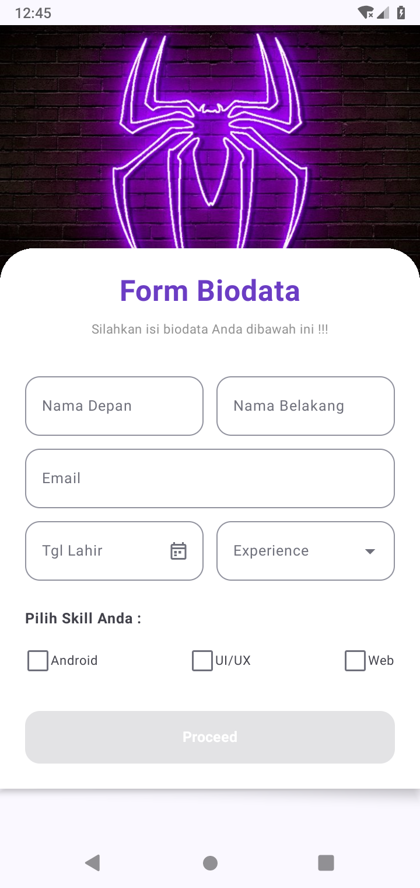
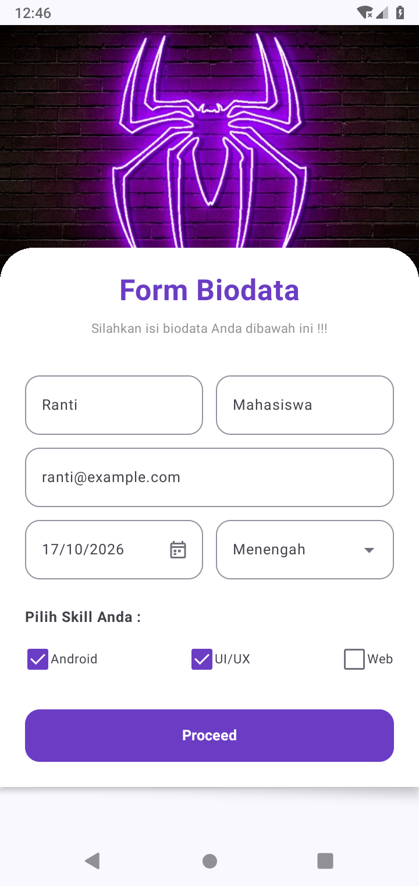

# QuestTugasUserInput_0278

Tugas Pengembangan Aplikasi Mobile: **Form Biodata** menggunakan Kotlin dan Jetpack Compose.

## Tampilan aplikasi

Hasil running pada emulator Android 9 / API 28. Data pada contoh adalah data demonstrasi.

| Form awal | Form lengkap | Hasil Proceed |
| --- | --- | --- |
|  |  |  |

## Fitur

- Header memakai gambar neon spider yang sudah tersedia di `res/drawable-nodpi/header_bg.jpeg`. Filter dari `res/values/image_filters.xml` menyelaraskan warna neon menjadi ungu seperti contoh tugas, sambil mempertahankan aset asli.
- Form berada dalam **Box** dengan sudut atas membulat dan bayangan, menumpuk di atas header pada **Scaffold**.
- Nama depan dan belakang sejajar; email berada pada baris tersendiri.
- Tanggal lahir memakai kalender dan tidak menerima tanggal setelah hari ini.
- Experience memakai dropdown: Pemula, Menengah, dan Mahir.
- Checkbox Android, UI/UX, dan Web dapat dipilih lebih dari satu; labelnya juga bisa diketuk.
- Proceed berwarna abu-abu dan nonaktif sampai nama, email valid, tanggal lahir, experience, dan minimal satu skill diisi.
- Proceed menampilkan ringkasan biodata. Tutup dialog untuk kembali mengedit.
- `rememberSaveable` mempertahankan input saat Activity dibuat ulang, termasuk rotasi layar.
- Form bisa digulir ketika layar pendek, mode landscape, atau keyboard terbuka.

## Kesesuaian aturan tugas

| Instruksi | Implementasi |
| --- | --- |
| Layout Jetpack Compose | `FormScreen.kt` |
| Box mengambang di atas Scaffold | `Box`, overlap header, rounded corners, dan shadow |
| Kata melalui resources | `res/values/strings.xml`, termasuk opsi dropdown, dialog, dan pesan validasi |
| Warna melalui resources | `res/values/colors.xml`, diakses dengan `colorResource` |
| Gambar melalui resources | `res/drawable-nodpi/header_bg.jpeg` dan `ic_calendar.xml` |
| Ukuran layout terpusat | `res/values/dimens.xml` |
| Nama repository sesuai 4 NIM belakang | `QuestTugasUserInput_0278` |
| Minimal 25 commit | Riwayat awal sudah memuat 28 commit; perubahan lanjutan mempertahankan seluruh riwayat tersebut |
| Hasil running di README | Screenshot emulator pada tabel di atas |

Tidak ada teks tampilan atau literal warna di kode Kotlin form. String kosong adalah nilai input awal; string test tag adalah identitas pengujian, bukan teks antarmuka.

## Menjalankan di Android Studio

1. Buka folder proyek ini menggunakan Android Studio yang mendukung **AGP 9.4.1**.
2. Gunakan **JDK 25** untuk Gradle, sesuai `gradle/gradle-daemon-jvm.properties` bawaan proyek.
3. Pasang Android SDK Platform **37.0**, SDK Build-Tools **36.0.0**, dan Platform-Tools melalui SDK Manager.
4. Tunggu **Sync Project with Gradle Files** selesai. Koneksi internet dibutuhkan pada unduhan dependensi pertama.
5. Pilih emulator atau perangkat Android **7.0 / API 24** atau lebih baru, lalu jalankan konfigurasi `app`.

Lokasi SDK lokal dibuat oleh Android Studio dalam `local.properties`; file tersebut tidak dibagikan karena berbeda pada setiap komputer.

### Build dan pengujian

Windows PowerShell:

```powershell
.\gradlew.bat assembleDebug testDebugUnitTest lintDebug assembleDebugAndroidTest
.\gradlew.bat connectedDebugAndroidTest
```

Linux/macOS:

```bash
./gradlew assembleDebug testDebugUnitTest lintDebug assembleDebugAndroidTest
./gradlew connectedDebugAndroidTest
```

Perintah kedua membutuhkan emulator/perangkat yang aktif. APK debug dihasilkan di `app/build/outputs/apk/debug/app-debug.apk`.

- `BiodataTest`: nama wajib, format email, tanggal tidak di masa depan, pilihan experience, dan minimal satu skill.
- `BiodataFormTest`: form awal, email salah, kalender, dropdown, checkbox, pembuatan ulang Activity, tombol Proceed, dan ringkasan.
- Pengujian perangkat menyimpan screenshot di direktori external files aplikasi, subfolder `screenshots`.

Untuk memperbarui gambar README setelah menjalankan pengujian:

```bash
adb pull /sdcard/Android/data/com.example.tugas5/files/screenshots/. docs/screenshots/
git add docs/screenshots README.md
git commit -m "Perbarui hasil running aplikasi"
```

Hasil pemeriksaan: **build berhasil, 6 unit test lulus, dan 1 uji antarmuka lengkap lulus**. Rincian tersedia di [docs/VERIFIKASI.md](docs/VERIFIKASI.md).

## Struktur utama

```text
app/src/main/java/com/example/tugas5/
  MainActivity.kt        # Entry point aplikasi
  FormScreen.kt          # Scaffold, header, form, dan dialog ringkasan
  Biodata.kt             # Model dan validasi
  ui/theme/Theme.kt      # MaterialTheme memakai warna resources
app/src/main/res/
  values/strings.xml     # Semua teks antarmuka
  values/colors.xml      # Semua warna form
  values/dimens.xml      # Dimensi layout
  drawable/              # Ikon kalender
  drawable-nodpi/        # Gambar header, tanpa penskalaan density otomatis
```

Aplikasi ini memproses input secara lokal dan tidak menyimpan biodata ke server atau database; tugas berfokus pada layout dan interaksi user input.
